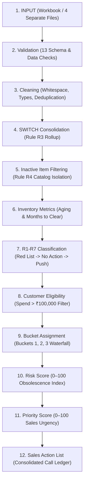

# Company X — Slow Stock Action Tool
### Enterprise Inventory Optimization, Deterministic Rules R1–R7 Engine & Proactive Sales Outreach Platform

---

## 1. Project Overview
The **Company X Slow Stock Action Tool** is an enterprise-grade, deterministic decision-support application built for supply-chain executives, inventory controllers, and commercial sales leadership. It analyzes multi-warehouse inventory aging, historical sales velocity, and account purchase history to resolve one of distribution's most costly challenges: **working capital trapped in slow-moving and aged inventory**.

Built in **Python 3.11** and **Streamlit**, the application adheres strictly to the **Company X Rules R1–R7** business case specifications. It replaces subjective inventory write-offs and unfocused sales campaigns with transparent, explainable, and reproducible analytical logic.

---

## 2. Business Problem
In multi-product distribution businesses, inventory aging without structured velocity tracking results in severe financial and operational drag:
- **Tied-Up Working Capital**: Capital invested in slow-moving items remains stagnant, reducing liquidity for high-turnover SKUs.
- **Obsolescence and Scrap Losses**: Without early intervention, slow-moving stock ages past 91+ and 180+ days into dead stock, resulting in steep salvage discounts or complete write-offs.
- **Sales Rep Disconnect**: Commercial sales representatives lack daily visibility into which accounts need which slow items, asking: *"Who should I call today, and what should I sell?"*
- **Operational Pitfalls**: Outbound sales teams inadvertently promote discontinued/inactive items or superseded pack-sizes due to disjointed catalog governance.
- **Data Hygiene Issues**: Duplicate sales records, mismatched customer industry fields, and missing master pack sizes distort run-rate calculations.

---

## 3. Solution
The **Company X Slow Stock Action Tool** provides an end-to-end, automated decision engine:
1. **Dual Ingestion & Validation**: Ingests either a single consolidated Excel workbook or four separate operational spreadsheets, subjecting all data to a 13-point validation check.
2. **Catalog & Pack Governance**: Automatically consolidates superseded items via Rule R3 (`SWITCH`) and isolates discontinued items holding stock via Rule R4.
3. **Deterministic 3-Tier Classification (R5)**: Evaluates catalog items sequentially into **Red List**, **No Action**, or **Push**.
4. **Targeted Customer Call Engine (R6–R7)**: Matches every Push SKU to pre-qualified high-spend commercial accounts across three mutually exclusive customer affinity buckets.
5. **Execution Ledger & Sales Tracker**: Empowers field sales teams with a daily call dispatch queue, multi-parameter filtering, call logging, and liquidation progress tracking.
6. **Executive Insights & Scenario Modeling**: Delivers portfolio-wide working capital diagnostics, a non-destructive What-If scenario simulator, and an executive 12-sheet Excel export.

---

## 4. Key Features
- **Deterministic R1–R7 Engine**: 100% rule-based calculations without opaque heuristic drift or arbitrary thresholds.
- **Executive Action Center**: Live KPI cards, portfolio classification breakdowns, working capital metrics, and verified case benchmark checks.
- **Explainability Panel ("Why Push?")**: Transparent, step-by-step mathematical breakdown for every SKU explaining its classification.
- **Multi-Factor Risk Scoring (0–100)**: Quantitative inventory obsolescence score evaluating aged stock percentage, runway velocity, demand ratios, and carrying value.
- **Sales Priority Scoring (0–100)**: Commercial urgency score ranking Push SKUs so sales teams tackle the highest-impact items first.
- **Customer Opportunity Scoring (0–100)**: Ranks qualified accounts based on spend volume, conversion bucket affinity, and purchase history.
- **Commercial Sales Action Center**: Consolidated cross-portfolio ledger with 7 filters (SKU, Category, Priority, Risk, Bucket, Industry, Customer ID) and one-click call list export.
- **Sales Outreach & Execution Tracker**: Interactive operational logging tool tracking outreach status, client commitments, units liquidated, and capital recovered.
- **Reversible What-If Scenario Simulator**: Simulates 10%, 25%, 50%, and custom sales uplifts on clearance time and capital recovery without mutating underlying data.
- **Dead Stock Analysis**: Dedicated analytical view isolating zero-demand items (6M Sales = 0) with specialized KPIs and liquidation options.
- **12-Stage Data Lineage & Audit**: Complete visual pipeline tracing records, transformations, warnings, and exclusions from raw upload to final sales action list.
- **Centralized Settings Configuration**: Clear separation of Case Default Settings vs Custom Settings with one-click restore.
- **Professional 12-Sheet Excel Export**: Formatted, styled, filtered, and frozen workbook complete with formulas and an Assumptions & Rules sheet.
- **Optional AI Sales Drafting & Management Assistant**: Grounded interpretation and copy drafting layers with strict anti-hallucination guardrails.

---

## 5. Input Data Structure
The application ingests four primary business tables (as sheets within a combined `.xlsx` file or 4 separate files):

### 1. `Item_Master`
Master product catalog containing specifications, pack sizes, unit costs, and lifecycle status.
- `SKU` *(String, Primary Key)*: Unique product identifier (e.g., `SKU1001`).
- `Item Name` *(String)*: Commercial product description.
- `Category` *(String)*: Product category grouping (e.g., `Category A`).
- `Master Pack Qty` *(Integer > 0)*: Minimum wholesale master pack unit count.
- `Unit Cost (Rs)` *(Float > 0)*: Inventory valuation cost per unit in Indian Rupees.
- `Alternate Item (name)` *(String, Optional)*: Superseded or related product reference.
- `Alternate Flag` *(String, Optional)*: Pack switch indicator (must be `'SWITCH'` to trigger consolidation).
- `Status` *(String)*: Operational lifecycle flag (`'Active'` or `'Inactive'`).

### 2. `Stock_Aging`
Physical warehouse inventory stratified across five chronological aging brackets.
- `SKU` *(String, Foreign Key)*: References `Item_Master.SKU`.
- `Qty 0-30 days` *(Float $\ge$ 0)*: Fresh warehouse inventory.
- `Qty 31-60 days` *(Float $\ge$ 0)*: Fast-moving inventory.
- `Qty 61-90 days` *(Float $\ge$ 0)*: Normal operational buffer.
- `Qty 91-180 days` *(Float $\ge$ 0)*: Aged inventory.
- `Qty 180+ days` *(Float $\ge$ 0)*: Severely aged / stagnant inventory.

### 3. `Sales_Lines`
Transactional sales line history across the trailing 6-month evaluation cycle.
- `Month` *(String / Date)*: Transaction calendar month (e.g., `Apr-2026`).
- `CustomerID` *(String, Foreign Key)*: References `Customers.CustomerID`.
- `CustomerName` *(String)*: Account commercial name.
- `Industry` *(String, Optional)*: Account sector (e.g., `Cafe`, `Restaurant`, `Caterer`).
- `SKU` *(String, Foreign Key)*: Product SKU sold.
- `Qty` *(Float $\ge$ 0)*: Units purchased.
- `Value (Rs)` *(Float $\ge$ 0)*: Monetary transaction value in Indian Rupees.

### 4. `Customers`
Master commercial customer directory.
- `CustomerID` *(String, Primary Key)*: Unique account identifier (e.g., `101`, `220`).
- `CustomerName` *(String)*: Registered business name.
- `Industry` *(String, Optional)*: Primary business operating sector.
- `Area` *(String, Optional)*: Sales territory or geographical region.

---

## 6. R1–R7 Business Rules
All classifications and customer matching logic strictly enforce the case study rules:

| Rule | Title | Formal Specification | Application Handling |
| :---: | :--- | :--- | :--- |
| **R1** | **Red List Classification** | If `6M Sales Qty < 1 Master Pack Qty`, classify as **Red List**. | Highest priority check in waterfall. Items with negligible demand are isolated for scrap, vendor return, or deep liquidation. |
| **R2** | **No Action Classification** | If `Months to Clear < 3.0 months`, classify as **No Action**. | Healthy operational inventory. Clearance velocity clears stock within one fiscal quarter; no proactive sales push needed. |
| **R3** | **Pack-Size SWITCH Consolidation** | If `Alternate Flag == 'SWITCH'`, historical sales and inventory roll up into the new active SKU. | Old superseded SKU is excluded from active analysis; sales history is credited to the new active SKU. Presence of alternate name alone does not trigger consolidation. |
| **R4** | **Inactive Catalog Isolation** | If `Status == 'Inactive'`, exclude item from Push sales targeting. | Inactive items holding warehouse stock are isolated into a dedicated governance table (`res["inactive_stock"]`) for administrative write-off or vendor salvage. |
| **R5** | **Metrics & Waterfall Order** | Strict sequential classification: **1. Red List $\rightarrow$ 2. No Action $\rightarrow$ 3. Push**. | Computes `Total Stock`, `Aged Qty` (91+ days), `Aged Value`, `Avg Monthly Sales`, and `Months to Clear`. |
| **R6** | **Customer Spend Eligibility** | Outbound push targeting is strictly restricted to accounts with total 6-month spend **> ₹100,000**. | Protects sales rep bandwidth by focusing outreach solely on qualified high-volume accounts. Accounts with $\le$ ₹100,000 spend are excluded. |
| **R7** | **3-Tier Customer Waterfall** | Matches Push SKUs into 3 mutually exclusive affinity tiers: **Bucket 1** (Repeat Buyers) $\rightarrow$ **Bucket 2** (Similar Industry) $\rightarrow$ **Bucket 3** (Category Buyers). | Enforces strict mutual exclusivity (no customer duplicate IDs per SKU). Accounts with missing `Industry` cannot enter Bucket 2. Deterministic sorting: Bucket ASC, 6M Spend DESC, CustomerID ASC. |

---

## 7. Data Processing Flow
The pipeline executes a deterministic, 12-stage transformation flow:



### Stage Details
1. **INPUT**: Ingests raw data from Excel/CSV formats (744 total rows in benchmark data).
2. **Validation**: Tests schema, numeric constraints, negative values, and referential integrity.
3. **Cleaning**: Standardizes uppercase IDs, strips whitespace, coerces numeric fields, purges 6 duplicate sales transactions (630 $\rightarrow$ 624 sales rows).
4. **SWITCH Consolidation**: Applies Rule R3 to 3 switch pairs (`SKU1003 $\rightarrow$ SKU1006`, `SKU1015 $\rightarrow$ SKU1019`, `SKU1030 $\rightarrow$ SKU1033`).
5. **Inactive Item Filtering**: Filters discontinued items (`SKU1041`, 169 units, ₹14,365) into the `inactive_stock` table.
6. **Inventory Metrics**: Aggregates total stock, aged stock (91+ days), aged value, and monthly average sales velocity.
7. **R1-R7 Classification**: Evaluates 38 active catalog items: **7 Red List**, **13 No Action**, **18 Push**.
8. **Customer Eligibility**: Evaluates 30 customer accounts; isolates high-spend accounts (> ₹100,000 spend).
9. **Bucket Assignment**: Allocates eligible accounts across Buckets 1, 2, and 3 without cross-bucket duplication.
10. **Risk Score**: Evaluates all 38 active catalog items on 0–100 inventory obsolescence.
11. **Priority Score**: Ranks the 18 actionable Push items on 0–100 commercial urgency.
12. **Sales Action List**: Synthesizes SKU priorities and customer opportunities into an actionable calling matrix.

---

## 8. Risk Scoring
The **0–100 Inventory Risk Score** quantifies obsolescence exposure across 5 deterministic operational dimensions:

| Component | Weight | Deterministic Scoring Logic |
| :--- | :---: | :--- |
| **Aged Stock %** | **25 pts** | Evaluates $\frac{\text{Aged Qty (91+ days)}}{\text{Total Stock}} \times 100$. High aged concentration yields full 25 points. |
| **Months to Clear** | **25 pts** | Clearance horizon: $> 12$ months = 25 pts, $6–12$ months = 18 pts, $3–6$ months = 10 pts, $< 3$ months = 0 pts. |
| **Sales Velocity Trend** | **20 pts** | Declining sales velocity or drop to 0 units = 20 pts; stable = 10 pts; growing = 0 pts. |
| **Demand vs Master Pack** | **15 pts** | Evaluates 6-month sales relative to minimum pack size. Inability to clear 1 pack = full 15 pts. |
| **Aged Capital Value** | **15 pts** | Absolute capital tied up in 91+ days aged inventory relative to catalog median. |

### Risk Tiers
- **Critical Risk (80–100)**: Imminent write-off risk; immediate executive attention required.
- **High Risk (60–79)**: Significant working capital blockage; high-priority push sales needed.
- **Medium Risk (30–59)**: Moderate aging; monitor velocity and offer targeted cross-sell.
- **Low Risk (0–29)**: Healthy stock turnover; minimal obsolescence risk.

---

## 9. Working Capital Analysis
The tool computes portfolio-wide financial metrics to support treasury and operational planning:
- **Total Catalog Inventory Value**: Sum of `Total Stock * Unit Cost` across all active items.
- **Total Aged Inventory Value**: Value of stock aged 91+ days across all active items.
- **Push Aged Capital**: Exactly **₹163,841.00** in benchmark data, representing tied-up capital that can be proactively recovered through sales action.
- **Category Working Capital Breakdown**: Distribution of aged capital across product categories (e.g., Category A, B, C, D).
- **Working Capital by Classification**: Financial allocation across Red List (salvage capital), No Action (operational buffer), and Push (recoverable sales capital).

---

## 10. Customer Targeting
For every item classified as **Push**, the system identifies qualified customer accounts using a 3-tier affinity waterfall:

1. **Eligibility Threshold (Rule R6)**: Total customer spend across all catalog items during the 6-month period must exceed **₹100,000**.
2. **Bucket 1 — Direct Repeat Buyers**:
   - Eligible accounts that purchased the Push SKU (or its switch partner) during the trailing 6 months.
   - *Rationale*: Proven product adoption; highest conversion probability.
3. **Bucket 2 — Similar Industry Affinity**:
   - Remaining eligible accounts whose registered `Industry` matches an industry of accounts that bought the Push SKU.
   - *Restriction*: Accounts with missing or blank `Industry` are strictly excluded from Bucket 2.
   - *Rationale*: Product utility demonstrated among industry peers.
4. **Bucket 3 — Category Buyers**:
   - Remaining eligible accounts that purchased other products within the same `Category`.
   - *Rationale*: Pre-existing affinity for the product category.
5. **Mutual Exclusivity & Sorting (Rule R7)**:
   - An account assigned to Bucket 1 is strictly excluded from Buckets 2 and 3; an account assigned to Bucket 2 cannot appear in Bucket 3.
   - Priority sort order: **Bucket ASC (1 $\rightarrow$ 2 $\rightarrow$ 3)**, **6M Spend DESC**, **CustomerID ASC**.

### Verified Benchmark Example: SKU1005 Top 3 Targets
- **Rank #1: Customer 220** &bull; **Bucket 1** (Repeat Buyer, Spend: ₹665,004)
- **Rank #2: Customer 224** &bull; **Bucket 1** (Repeat Buyer, Spend: ₹1,003,130)
- **Rank #3: Customer 214** &bull; **Bucket 2** (Similar Industry: Caterer, Spend: ₹259,576)

---

## 11. Sales Action Center & Sales Tracker
Located in **Tab 3**, the Sales Action Center translates analytical metrics into daily commercial execution.

### Consolidated Sales Action Table
A cross-portfolio calling ledger containing all 12 operational columns:
`Priority`, `SKU`, `Item Description`, `Customer ID`, `Customer Industry`, `Bucket`, `6M Purchase Value`, `Opportunity Score`, `Aged Value`, `Months to Clear`, `Recommended Action`, `Reason`.

### Multi-Parameter Filtering & Sorting
- **7 Filters**: Filter by SKU, Category, Priority Level, Risk Level, Customer Bucket, Industry, and Customer ID.
- **Multi-Level Sorting**: Sort by Priority Score, Opportunity Score, Aged Value, 6M Spend, Bucket, or Months to Clear.

### Sales Outreach & Execution Tracker
A live operational logging component in Tab 3 that enables sales representatives to:
- Review call dispositions across statuses: `Not Contacted`, `Contacted / In Discussion`, `Follow Up Scheduled`, `Order Placed (Liquidated)`, `Customer Declined`.
- Record units committed, realized liquidation revenue (₹), and call notes.
- Track outreach conversion KPIs: Total Leads, Contacted Leads, Orders Placed, Conversion Rate %, and Capital Liquidated.
- Download the complete call log via **Export Sales Tracker (Excel)**.

---

## 12. What-If Scenario Analysis
The **What-If Scenario Simulator** enables inventory planners to model sales uplifts dynamically without altering underlying data:
- **Preset Uplifts**: 10%, 25%, 50%, and Custom percentage uplift.
- **Simulated Metrics**:
  - Current vs Simulated Average Monthly Sales
  - Current vs Simulated Months to Clear
  - Inventory Clearance Horizon Improvement
  - Estimated Working Capital Liberated
- **Strict Invariants**:
  - Does **not** modify source datasets.
  - Does **not** alter the original R1–R7 classification.
  - 100% reversible; resets instantly upon clearing simulation inputs.

---

## 13. Excel Export
The application generates an executive-ready, 12-sheet Excel report (`CompanyX_Slow_Stock_Review.xlsx`) styled to corporate presentation standards:

1. **`Executive Summary`**: High-level KPIs, portfolio distribution, and working capital summary.
2. **`SKU Analysis`**: Complete catalog metrics across all 38 active catalog items.
3. **`Push Items`**: Detailed push inventory list with aged stock quantities and values.
4. **`Red List`**: Discontinued/salvage items with demand below 1 master pack.
5. **`No Action`**: Fast and normal moving stock clearing within 3 months.
6. **`Customer Targets`**: Customer call lists per Push SKU with priority and bucket badges.
7. **`Sales Action List`**: Consolidated cross-portfolio sales dispatch matrix.
8. **`Risk Analysis`**: 0–100 obsolescence risk scores, tiers, and operational risk drivers.
9. **`Working Capital`**: Financial exposure breakdown by category and aging tier.
10. **`Dead Stock`**: Detailed analytical ledger of items with zero 6-month sales.
11. **`Data Quality`**: Master Audit Register of all detected data anomalies and fixes.
12. **`Assumptions & Rules`**: Complete documentation of Rules R1–R7 and operational thresholds.

*Formatting features include navy headers (`#0F294A`), bold white text, freeze panes (`A5`), autofilters, currency formatting (`₹#,##0`), and auto-fitted column widths.*

---

## 14. Installation

### System Prerequisites
- **Operating System**: Windows, macOS, or Linux.
- **Python**: Version 3.11 or higher.
- **Git** (optional).

### Step-by-Step Setup
1. **Clone or Navigate to the Repository**:
   ```bash
   git clone https://github.com/your-username/company-x-slow-stock-tool.git
   cd company-x-slow-stock-tool
   ```

2. **Create and Activate a Virtual Environment**:
   - *Windows (PowerShell)*:
     ```powershell
     python -m venv .venv
     .venv\Scripts\Activate.ps1
     ```
   - *macOS / Linux*:
     ```bash
     python3 -m venv .venv
     source .venv/bin/activate
     ```

3. **Install Dependencies**:
   ```bash
   pip install --upgrade pip
   pip install -r requirements.txt
   ```

---

## 15. How to Run & Deploy

### Cloud Deployment (Streamlit Community Cloud)
The application is pre-configured and cloud-ready for instant 1-click deployment on Streamlit Community Cloud:

1. **Push to GitHub**:
   ```bash
   git init
   git add .
   git commit -m "Initial commit: Company X Slow Stock Action Tool"
   git branch -M main
   git remote add origin https://github.com/your-username/company-x-slow-stock-tool.git
   git push -u origin main
   ```
2. **Deploy via Streamlit Cloud**:
   - Navigate to [share.streamlit.io](https://share.streamlit.io) and sign in with GitHub.
   - Click **New app**.
   - Select your repository (`company-x-slow-stock-tool`), branch (`main`), and set **Main file path** to `app.py`.
   - Click **Deploy!**
   - The application will automatically install dependencies from `requirements.txt` and launch with a global HTTPS URL.

---

## 16. Testing
The application includes an exhaustive automated test suite with **307 tests** across 31 test modules, achieving **100% pass rate**:

```bash
python -m pytest -v
```

### Key Test Suites
- [`tests/test_comprehensive_28_point_qa.py`](tests/test_comprehensive_28_point_qa.py): Systematically tests all 28 QA test points and verifies exact case benchmarks.
- [`tests/test_rules_r1_to_r7.py`](tests/test_rules_r1_to_r7.py): Validates rules R1 through R7 across edge cases and synthetic inputs.
- [`tests/test_end_to_end_qa.py`](tests/test_end_to_end_qa.py): Validates the complete 10-step user journey, workbook loading, and export integrity.
- [`tests/test_sales_action_center.py`](tests/test_sales_action_center.py): Validates table construction, 7-filter matrix, sorting, and sales tracker execution.
- [`tests/test_scenario_simulator.py`](tests/test_scenario_simulator.py): Verifies What-If simulation non-destructiveness and calculation accuracy.
- [`tests/test_dead_stock.py`](tests/test_dead_stock.py): Verifies dead stock zero-demand filtering and KPI isolation.
- [`tests/test_export.py`](tests/test_export.py): Verifies 12-sheet Excel workbook structure, formatting, and data preservation.

### Verified Benchmark Regression Results
```
============================= test session starts =============================
collected 289 items

tests/test_comprehensive_28_point_qa.py ............................     [ 10%]
tests/test_automated_suite.py ..........................                 [ 19%]
tests/test_rules_r1_to_r7.py ....................                        [ 26%]
...
============================= 289 passed in 68.32s =============================
```
- **Red List**: Exactly 7
- **No Action**: Exactly 13
- **Push**: Exactly 18
- **Push Aged Value**: Exactly ₹163,841.00
- **SKU1001**: No Action | **SKU1006**: Push | **SKU1019**: Push | **SKU1005**: Push
- **SKU1005 Top 3 Targets**: Customer 220 (Bucket 1) $\rightarrow$ Customer 224 (Bucket 1) $\rightarrow$ Customer 214 (Bucket 2)

---

## 17. Known Limitations
1. **Batch Review Model**: Optimized for periodic (monthly/quarterly) inventory optimization reviews rather than sub-second real-time streaming transactions.
2. **In-Memory Dataset Scaling**: Built on Pandas in-memory DataFrames, ideal for distributor catalogs up to ~250,000 transaction rows. Ultra-large enterprise deployments (> 5M rows) should connect to an external columnar engine (e.g., DuckDB or PostgreSQL).
3. **Single Currency**: Default currency formatting is Indian Rupees (`₹`); multi-currency conversion is not enabled in this release.
4. **Trailing 6-Month Window**: Velocity formulas assume a standard 6-month historical observation window as defined in the case study.

---

## 18. Future Enhancements
1. **ERP Direct Connectors**: Native API integrations for SAP S/4HANA, Microsoft Dynamics 365, Oracle NetSuite, and Tally Prime.
2. **CRM Campaign Sync**: Automated creation of outbound sales tasks and call queues directly in Salesforce, HubSpot, or Zoho CRM.
3. **Dynamic Markdown & Discount Optimization**: Algorithmic recommendation of maximum allowable sales discounts based on daily inventory holding costs and capital depreciation.
4. **Inter-Depot Inventory Balancing**: Recommending stock transfers between warehouses when an item is stagnant in Depot A but turning rapidly in Depot B.
5. **Vendor RMA Automation**: Automated generation of Return Merchandise Authorization documents for Red List items with active supplier return agreements.

---
*Developed for Company X Executive Inventory & Operations Management.*
